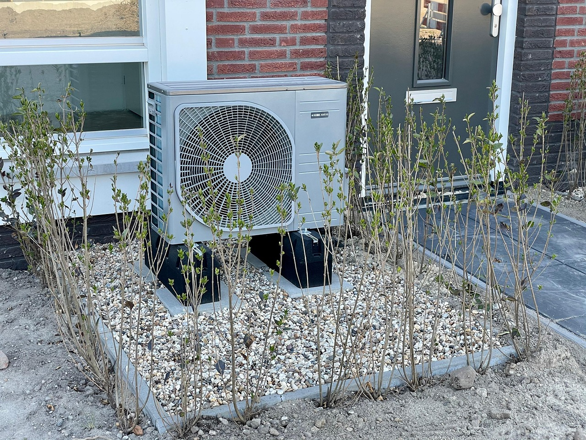

[Research explainer · Building energy and urban climate]{.eyebrow}

**Could widespread heat-pump heating and cooling change local outdoor temperatures?** Our [2024 paper in *Sustainable Cities and Society*](https://doi.org/10.1016/j.scs.2024.105811) investigated this through coupled building and urban climate simulations for future UK scenarios.

<figure class="explainer-photo" id="heat-pump-installation">
  
  <figcaption>Photo: <a href="https://pixabay.com/photos/heat-pump-gas-energy-renewable-6209793/">HarmvdB / Pixabay</a></figcaption>
</figure>

## The physical question

In cooling mode, a heat pump releases indoor heat and the heat from its electricity use outdoors. In heating mode, it draws heat from the outdoor air. We examined how these exchanges change **anthropogenic heat**—heat associated with human activities—and local air temperature.

## How the study worked

The modelling framework combined:

- **EnergyPlus**, to represent building thermal behaviour, heating and cooling demand, and heat exchanges.
- **[SUEWS](https://suews.io/)**, to represent the neighbourhood surface energy balance and local meteorological conditions.

EnergyPlus heat emissions informed SUEWS neighbourhood temperatures, which fed into the next EnergyPlus run. The models exchanged annual time series until successive 2 m temperature estimates differed by less than 0.01°C.

**Scenarios:** heat pumps supplied both heating and cooling; the gas-boiler reference supplied heating with **no active summer cooling**.

The idealised neighbourhoods contained identical detached houses or low-rise flats, with 50% building coverage and post-1996 fabric. Weather inputs were UKCP09-derived Design Summer Years for 2040–2059 under the medium-emissions scenario. London was the detailed case; the nine-city comparison used flats.

## What the simulations found

For the **idealised London flats neighbourhood**, the **example-day peak differences** from the gas-boiler reference were (Fig. 7):

::: {.table-scroll role="region" aria-label="Modelled heat-pump results, horizontally scrollable" tabindex="0"}
| London flats scenario | Change in building anthropogenic heat | Change in neighbourhood 2 m air temperature |
|:---|:---|:---|
| Illustrative hot day, 20 July | Peak increase of **19.3 W/m²** | Peak increase of **0.12°C** |
| Illustrative cold day, 8 February | Reduction up to **11.1 W/m²** | Reduction up to **0.16°C** |
:::

Summer cooling added heat outdoors, while replacing boilers with heat pumps reduced winter heat emissions.

## Study scope {#limits-of-the-evidence}

The results describe neighbourhood air temperature at 2 m. Building diversity, older fabric, climate, occupancy and operating practices can change the response. Traffic and other non-residential heat sources were excluded, and sequential coupling does not resolve feedback at every timestep.

## Why this is useful

The framework assesses heating and cooling options for both building energy demand and neighbourhood temperature. This work was associated with the [2024 CIBSE Building Simulation Award](../../background/index.qmd#cibse-award).

## Original publication and data

Xiaoxiong Xie, Zhiwen Luo, Sue Grimmond, Yiqing Liu, Carlos E. Ugalde-Loo, Matthew T. Bailey and Xinfang Wang (2024). **Could residential air-source heat pumps exacerbate outdoor summer overheating and winter overcooling in UK 2050s climate scenarios?** *Sustainable Cities and Society*, 115, 105811. [doi:10.1016/j.scs.2024.105811](https://doi.org/10.1016/j.scs.2024.105811).

[Open-access paper](https://researchportal.plymouth.ac.uk/en/publications/could-residential-air-source-heat-pumps-exacerbate-outdoor-summer/) · [Dataset on Zenodo](https://zenodo.org/records/13351764)

The Zenodo record describes weather inputs, a modelling notebook and simulation outputs. **Files are restricted-access**; requests can be made through the record.

[Explore the wider research programme →](../index.qmd#low-carbon-technologies)
