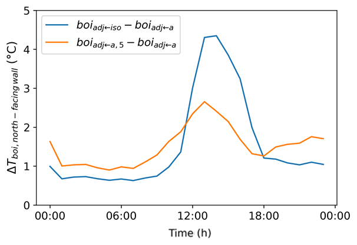
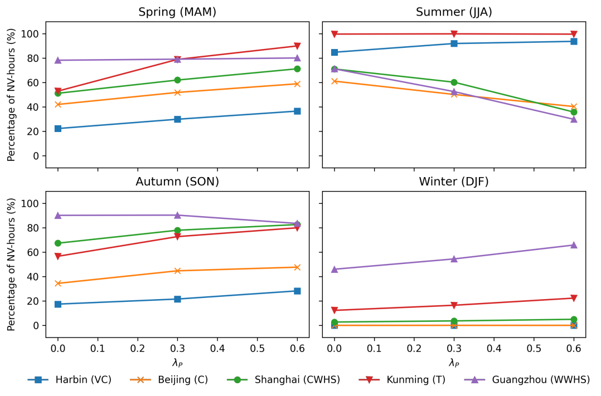
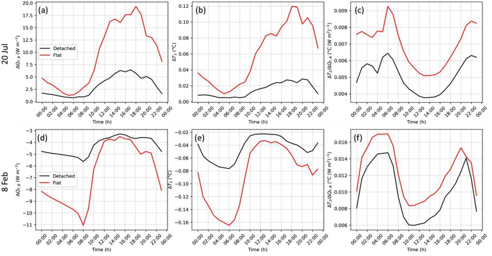
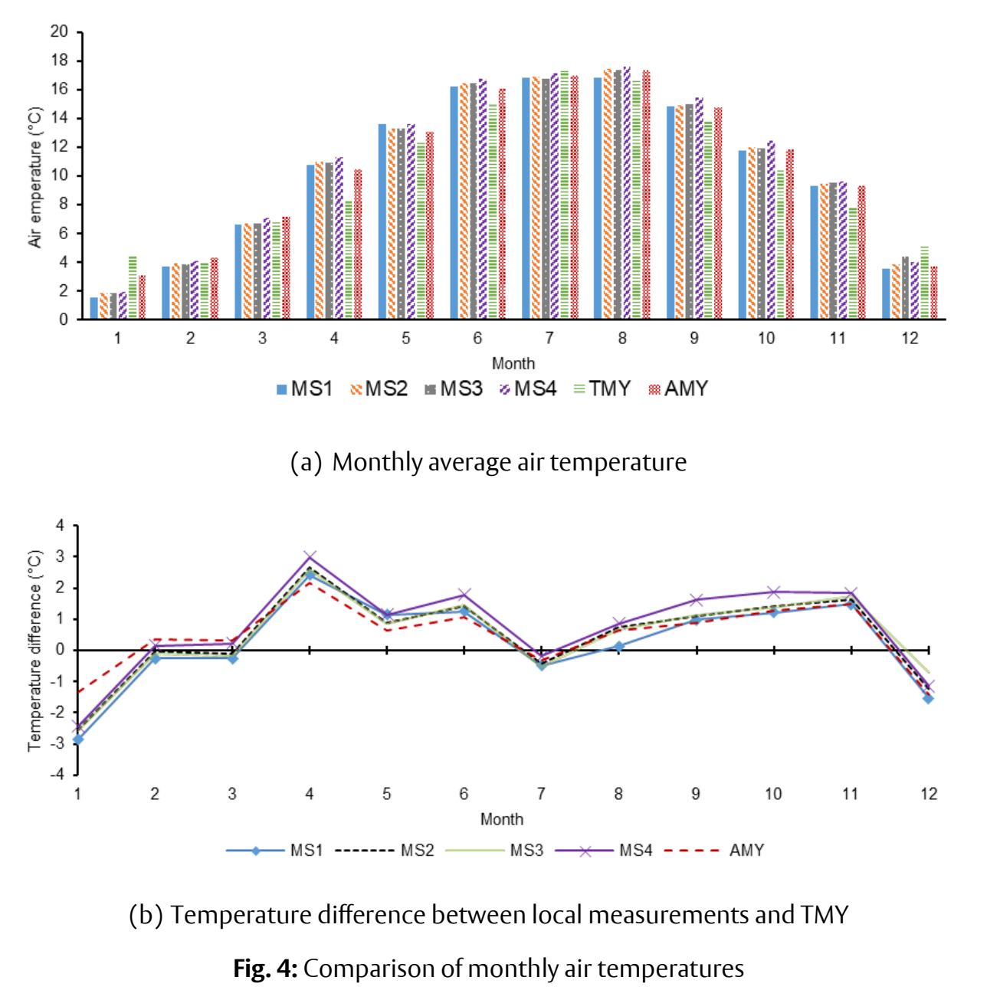

::: {.page-intro}
How does a building's urban setting change its performance—and how do its energy systems change that setting?
:::

I combine the Surface Urban Energy and Water Balance Scheme (**[SUEWS](https://suews.io/)**) with **EnergyPlus**, alongside fixed and mobile monitoring of conditions around buildings and along urban routes.

## Bringing urban climate into building simulation {#urban-building-interactions .research-topic}

::: {.research-question}
What changes when we simulate a building as part of a neighbourhood?
:::

In our 2022 study, we represented **longwave radiation between buildings** by iteratively updating neighbouring surface temperatures, instead of assuming they equal air temperature.

**Key results.** In a dense London neighbourhood on a clear winter day, isolated-building temperatures gave a larger simulated midday wall-temperature rise than the iterative method. Across the London simulations, accounting for neighbouring surfaces increased cooling demand and reduced heating demand compared with the air-temperature assumption.

::: {.research-figure}
::: {.figure-actions}
[Open full-size figure](../assets/research/xie-2022-radiation-fig9.webp){.figure-open aria-label="Open full-size longwave radiation figure"}
:::

{#fig-radiation-loads fig-alt="Hourly simulated wall-temperature differences on a clear winter day. The blue isolated-building curve peaks above 4 degrees Celsius around midday; the orange iterative curve peaks below 3 degrees Celsius. Both are compared with the air-temperature assumption." width=606 height=417 loading=lazy}

::: {.figure-source}
Source: [Xie et al. (2022), Fig. 9](https://centaur.reading.ac.uk/101466/ "Accepted manuscript") · [CC BY-NC-ND 4.0](https://creativecommons.org/licenses/by-nc-nd/4.0/). © 2021 Elsevier.
:::
:::

::: {.generated-paper paper-id="xie-2022-radiation"}
:::

Related studies:

- **Local weather:** [Tang et al. (2021)](../publications/index.qmd#tang-2021-weather), a collaborative study, combined ERA5 and SUEWS to construct urban weather inputs and vertical profiles for EnergyPlus.
- **Wind-driven ventilation:** my [2023 study](../publications/index.qmd#xie-2023-wind-pressure) examined how pressure coefficients and reference wind speeds affect simulated ventilation and energy use in isolated and surrounded buildings.

## Natural ventilation and climate-resilient retrofit {#climate-resilient-retrofit .research-topic}

::: {.research-question}
When can natural ventilation reduce cooling demand in a dense neighbourhood?
:::

Our 2023 study supplied SUEWS temperature, humidity and wind profiles to EnergyPlus to assess ventilation and cooling demand at **three idealised neighbourhood densities in five Chinese cities**.

**Key results.** With 60% building coverage, simulated summer hours suitable for upper-floor cross ventilation were **10% higher in Harbin and 43% lower in Guangzhou** than in the rural reference. The effect of urban density depended on climate and season.

::: {.research-figure}
::: {.figure-actions}
[Open full-size figure](../assets/research/xie-2023-density-fig10.webp){.figure-open aria-label="Open full-size natural ventilation figure"}
:::

{#fig-density-ventilation fig-alt="Four seasonal plots for five Chinese cities. In summer, natural ventilation hours rise with building density in Harbin but fall in Guangzhou, Shanghai and Beijing; the pattern changes in other seasons." width=1078 height=711 loading=lazy}

::: {.figure-source}
Source: [Xie et al. (2023), Fig. 10](https://discovery.ucl.ac.uk/id/eprint/10174326/ "Accepted manuscript") · [CC BY 4.0](https://creativecommons.org/licenses/by/4.0/).
:::
:::

::: {.generated-paper paper-id="xie-2023-density"}
:::

**Related project.** [UMAR](../projects/index.qmd#umar) applied urban–building modelling to climate-resilient retrofit of Plymouth social housing.

## Heat pumps and urban energy exchange {#low-carbon-technologies .research-topic}

::: {.research-question}
What happens outdoors when residential heating and cooling move to air-source heat pumps?
:::

Our 2024 study used **sequential SUEWS–EnergyPlus coupling** to model neighbourhood heat exchange in UK residential scenarios for the 2050s. The reference homes used **gas heating and no active summer cooling**.

**Key results.** For London flats, the largest modelled changes in neighbourhood air temperature at 2 m were **+0.12°C on the hot day (20 July)** and **−0.16°C on the cold day (8 February)**. Detached houses showed smaller changes.

::: {.research-figure}
::: {.figure-actions}
[Open full-size figure](../assets/research/xie-2024-heat-pumps-fig7.webp){.figure-open aria-label="Open full-size heat-pump figure"}
:::

{#fig-heat-pump-days fig-alt="Six-panel model result: flats show larger temperature changes than detached houses, reaching +0.12 degrees Celsius on 20 July and −0.16 degrees Celsius on 8 February relative to gas heating with no active summer cooling." width=2000 height=1042 loading=lazy}

::: {.figure-source}
Source: [Xie et al. (2024), Fig. 7](https://doi.org/10.1016/j.scs.2024.105811 "Published version") · [CC BY 4.0](https://creativecommons.org/licenses/by/4.0/).
:::
:::

[Heat-pump research explainer](heat-pumps/index.qmd)

::: {.generated-paper paper-id="xie-2024-heat-pumps"}
:::

Related collaborative work examines [anthropogenic heat in Colombo](../publications/index.qmd#blunn-2024-colombo) and [humidity-driven changes in air-conditioning demand](../publications/index.qmd#li-2026-humidity).

## Monitoring urban microclimates {#thermal-exposure .research-topic}

::: {.research-question}
What can fixed and mobile measurements tell us about local conditions for buildings and people?
:::

### Fixed monitoring around a building {#fixed-monitoring}

Our 2020 study combined **a year of observations from four fixed weather stations** around a University of Reading campus building with simulations of heating demand and night-ventilation cooling potential.

**Key results.** Local air temperatures were higher than the typical meteorological year (TMY) reference in most months. Using local weather changed simulated annual heating demand by up to **10.8%** compared with TMY inputs.

::: {.research-figure}
::: {.figure-actions}
[Open full-size figure](../assets/research/xie-2020-monitoring-fig4.webp){.figure-open aria-label="Open full-size fixed-station monitoring figure"}
:::

{#fig-local-temperatures fig-alt="Two panels show monthly mean air temperatures and differences from TMY for four fixed stations around a Reading campus building, alongside reference weather data. Local temperatures exceed the TMY reference in most months, with differences varying by station and season." width=1305 height=1305 loading=lazy}

::: {.figure-source}
Source: [Xie et al. (2020), Fig. 4](https://centaur.reading.ac.uk/87507/ "Accepted manuscript") · [CC BY-NC-ND 4.0](https://creativecommons.org/licenses/by-nc-nd/4.0/).
:::
:::

::: {.generated-paper paper-id="xie-2020-neighbourhood"}
:::

### Mobile monitoring along urban routes {#mobile-monitoring}

I co-authored [Lam et al. (2025)](../publications/index.qmd#lam-2025-monitoring), **led by [Charlie Lam](https://www.plymouth.ac.uk/staff/cho-kwong-charlie-lam)**. Trolley-based monitoring sampled thermal conditions and air quality along Plymouth walking routes in May–June 2024, capturing variation across urban settings.

**Related collaborative work.** [He et al. (2025)](../publications/index.qmd#he-2025-gap-filling) compared regression, random forests and neural networks to estimate missing temperatures in London's citizen weather-station records.

## Explore further {#methods-and-evidence}

[Publications](../publications/index.qmd) · [Funded projects](../projects/index.qmd) · [Collaboration and PhD enquiries](../index.qmd#collaboration)
